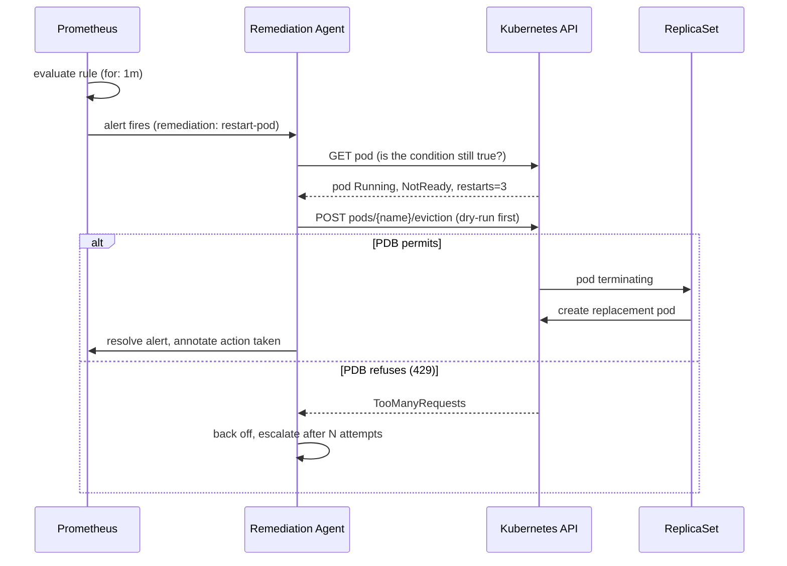

# Self-Healing Kubernetes Cluster — Design

**Status:** draft v0.1 · **Scope:** local (minikube + Floci) with a defined path to
AWS EKS via Terraform

**Companion documents:** `[runbook.md](runbook.md)` for operational procedures ·
`[adr/](adr/README.md)` for the decisions behind this architecture. This document
states *what* the system is; the ADRs state *why*, and record what was rejected.

---

## 1. Purpose and scope

This document describes an architecture for a Kubernetes cluster that detects and
remediates its own failures across three independent tiers: kubelet probe
remediation, control-plane controller reconciliation, and an external
metrics-driven agent. The local environment runs on minikube with Floci standing
in for AWS APIs; the production target is Amazon EKS provisioned with Terraform.

### 1.1 Goals

- Demonstrate self-healing that works with **no external agent**, and show
precisely where an agent adds capability beyond that baseline.
- Make every remediation path **observable and time-bounded**: each mechanism has
a stated detection latency and blast radius.
- Encode **safety limits** (disruption budgets, rollout limits, stabilisation
windows) so that self-healing cannot amplify an outage.
- Keep the local topology **structurally identical** to the EKS target, so
behaviour observed locally is meaningful.

### 1.2 Non-goals

- Multi-cluster or multi-region failover.
- Machine-learning-based anomaly detection. Thresholds are explicit and tunable.
- Replacing GitOps. The agent performs *remediation*, never configuration drift
correction; a GitOps controller remains the source of truth for desired state.
- High availability of the observability stack itself (a single Prometheus
suffices locally; see §12.3 for the production note).

---

## 2. Terminology: what "self-healing" actually means

The term is overloaded. This design distinguishes four capabilities, because they
have very different costs and failure modes:

| Capability     | Question answered          | Mechanism                 | Latency |
| -------------- | -------------------------- | ------------------------- | ------- |
| **Restart**    | Is this process wedged?    | kubelet liveness probe    | ~40 s   |
| **Replace**    | Is this pod beyond saving? | ReplicaSet reconciliation | ~15 s   |
| **Reschedule** | Is this node gone?         | scheduler + controllers   | ~60 s   |
| **Rescale**    | Is demand beyond capacity? | HPA                       | ~60 s   |

A system that only does the first is often described as self-healing, but it will
happily restart a container forever without ever resolving the fault. This design
treats **restart as the weakest and last-resort remedy**, not the primary one.

---

## 3. Architecture overview

The system is a control loop in the MAPE-K sense: Monitor, Analyse, Plan, Execute,
sharing Knowledge (cluster state).

```
                            ┌──────────────────────────────────────────┐
                            │            EXTERNAL AGENT (Tier 2)        │
                            │   Prometheus ──alert──▶ Remediation Agent │
                            │        ▲                      │           │
                            └────────┼──────────────────────┼───────────┘
                                     │ scrape               │ K8s API
                                     │                      │ (evict/patch)
   ┌─────────────────────────────────┼──────────────────────▼───────────┐
   │  CONTROL PLANE (Tier 1)          │                                  │
   │   Deployment controller · ReplicaSet · HPA · PDB · scheduler         │
   │        ▲                             │                              │
   │        │ watch / reconcile           │ create/evict pods            │
   └────────┼─────────────────────────────┼──────────────────────────────┘
            │                             ▼
   ┌────────┼────────────────────────────────────────────────────────────┐
   │  KUBELET (Tier 0)   probe ──▶ restart container                     │
   │        │                                                            │
   │   ┌────┴─────────────────┐   ┌──────────────────┐                   │
   │   │  demo-api pod        │   │  demo-api pod    │  ... replicas     │
   │   │  /healthz /readyz    │   │                  │                   │
   │   │  /metrics            │   │                  │                   │
   │   └──────────────────────┘   └──────────────────┘                   │
   └─────────────────────────────────────────────────────────────────────┘
```

The critical structural property: **Tier 0 operates without the control plane and
without the network.** The kubelet restarts a failed container even if the API
server is unreachable and Prometheus is down. Every higher tier is an
enhancement, not a dependency, of the tier below it.

### 3.1 The three tiers

| Tier | Component          | Detects                  | Acts by                     | Time to detect | Survives control-plane outage |
| ---- | ------------------ | ------------------------ | --------------------------- | -------------- | ----------------------------- |
| 0    | kubelet (per node) | failed probe             | restarting the container    | 10–30 s        | yes                           |
| 1    | controllers        | desired≠actual           | creating/evicting pods      | 1–15 s         | no                            |
| 2    | external agent     | metric threshold / alert | eviction, patch, annotation | 1–5 min        | no                            |

**Design rule.** A fault must be handled at the *lowest* tier capable of resolving
it. Tier 2 is reserved for conditions that cannot be expressed as a probe or a
reconciliation rule — a p99 latency SLO breach, a queue-depth anomaly, a
certificate nearing expiry. Reaching for an agent before exhausting Tiers 0 and 1
is the most common architectural mistake in this space, because the agent is
slower, needs credentials, and is itself a thing that can fail.

---

## 4. Tier 0 — probe-driven remediation

Manifests: `[k8s/10-deployment.yaml](../k8s/10-deployment.yaml)`

Three probes with deliberately different tuning, because they answer different
questions:

| Probe            | Question                 | Tuning                            | Effect of failure                    |
| ---------------- | ------------------------ | --------------------------------- | ------------------------------------ |
| `startupProbe`   | has it finished booting? | period 5 s, threshold 24 (≤120 s) | restart, while liveness is suspended |
| `readinessProbe` | should it get traffic?   | period 5 s, threshold 2 (~10 s)   | removed from Service endpoints       |
| `livenessProbe`  | is it wedged?            | period 10 s, threshold 3 (~30 s)  | container restart                    |

The tuning asymmetry is the whole point. **Readiness should be fast and tight;
liveness should be slow and forgiving.** Conflating them produces the classic
probe-induced outage:

> A liveness probe pointed at an endpoint that depends on a downstream service
> turns a downstream slowdown into a cluster-wide restart storm. Every replica
> fails the probe simultaneously, every replica restarts simultaneously, and the
> outage is now caused by the health check rather than the dependency.

Concrete rules applied here:

1. **Liveness checks process liveness only.** `/healthz` returns non-200 only when
  the process itself is broken — never because a dependency is slow. Dependency
   health belongs in readiness, which sheds traffic without restarting anything.
2. `**startupProbe` gates `livenessProbe`.** A slow boot cannot be mistaken for a
  wedged process.
3. `**terminationGracePeriodSeconds: 30` exceeds the app's 5 s drain**, so in-flight
  requests complete during a rolling update instead of being cut off.

### 4.1 The demo workload's runtime constraint

The target application (`app/app.py`) is Flask served by gunicorn with 4 worker
processes. That worker count is not incidental: it constrains how fault state can
be stored.

A fault flag held in a module-level variable would be set in exactly one worker.
The kubelet's next liveness probe may land on any worker, so roughly three times
in four it would return 200 and the injected fault would be invisible; a
Prometheus scrape of `/metrics` would likewise report the pod healthy while it is
faulted, silently defeating the `DemoApiUnhealthy` alert.

Fault state is therefore written to a file on a shared `emptyDir`
(`FAULT_STATE_FILE`) and read on every probe and scrape, so behaviour is
identical regardless of worker count. Writes are atomic — write to a temp file,
`fsync`, then `os.replace` — so a concurrent reader never observes a partial
write. This was verified by faulting one process and confirming another
immediately reports unhealthy.

The `emptyDir` choice also means fault state is ephemeral by design: a replaced
pod starts healthy, which is what the `app-fail` scenario depends on.

**A container restart is not a pod replacement.** `emptyDir` is ephemeral per
*pod*, not per *container*: a container restart keeps the pod, and therefore keeps
its volume, so a file-backed fault flag survives it. Left alone that produces a
permanent crash loop — the kubelet restarts the container, the fresh process reads
the persisted flag, fails the startup probe, and is killed again before liveness
or readiness ever pass. Liveness remediation therefore cannot heal a file-backed
fault on its own, *even though liveness is exactly the tier that is supposed to
handle a wedged process*.

This is the sharpest failure mode in the whole system, because it is a fault
where **the healer is the thing keeping the fault alive**. It was found by
running the scenario, not by reading it: the first `app-fail` run reported
success while the third run entered an unbounded restart loop. Three properties
made it hard to see:

1. **The pod looks like it is healing.** `restartCount` increments, which is the
   textbook signal that liveness remediation fired. A script that checks only
   that number reports success on a crash loop.
2. **Every layer behaves correctly in isolation.** The probe is right to fail,
   the kubelet is right to restart, the volume is right to persist. The bug lives
   in the composition, so no single-component review finds it.
3. **The volume lifetime is invisible in the manifest.** `emptyDir` reads as
   "ephemeral" at a glance; the pod-scoped-not-container-scoped distinction is
   documented but easy to skim past.

The fix has two halves, and the ordering between them matters:

- **Clear at startup** (`_clear_fault_on_start`, at import time). This is the
  load-bearing half: it covers *every* restart path, including `SIGKILL` and OOM
  kills, where no shutdown handler runs at all. A shutdown-only fix would leave
  the `SIGKILL` case broken.
- **Clear at graceful exit** (`atexit`). This keeps the file clean for the
  next process and for inspection, but it is a convenience, not the guarantee.

Deliberately **not** a `SIGTERM` handler: gunicorn already installs its own
signal handling and shutdown sequence, and adding a competing handler risks
interfering with in-flight request draining for no additional safety.

The scenario now asserts the pod returns to `Ready` rather than merely observing
a restart-count bump — the assertion that would have caught this the first time.
`FAULT_STATE_PERSIST=1` disables both clears for experiments that deliberately
need a fault to outlive a restart.

The generalisable rule: **any state that outlives the process it is meant to
describe must be cleared on startup, not on shutdown.** Startup is the only hook
that runs on every path back from a dead process.

### 4.2 Detection latency budget (Tier 0)

Detection time is not instantaneous; it is mechanically determined by the probe
configuration:

```
readiness:  periodSeconds × failureThreshold  =  5 s × 2  = 10 s   (worst case)
            + timeoutSeconds                  =             2 s   →  ~12 s
            + endpoint propagation            =             1–2 s →  ~14 s

liveness:   periodSeconds × failureThreshold  = 10 s × 3  = 20–30 s
            + timeoutSeconds                  =         n/a (see below)
            + container restart + boot        =            5–10 s →  ~25–40 s
```

`timeoutSeconds` does **not** appear in the liveness path. It bounds a probe that
*hangs*; `/healthz` under fault returns 500 immediately, so the probe completes and
the timeout never applies. Adding it (as an earlier revision of this document did,
to reach ~43 s) measures the wrong failure mode.

**Readiness detection is a range, not a point.** The readiness figures above are
the *worst case*. The kubelet samples on a fixed period, but a fault appears at
an arbitrary offset within that period, so the number of failed probes the
kubelet actually observes before acting depends on where in the cycle the fault
landed:

```
readiness  (periodSeconds 5, failureThreshold 2)
  fast  end: the 2 required probes land immediately →  5 s + 2 s + 1–2 s =  ~7–9 s
  slow  end: a full period is "wasted" first        → 10 s + 2 s + 1–2 s = ~12–14 s
```

**Liveness detection is a range for the same reason**, derived the same way. The
threshold is three *consecutive* failures at `periodSeconds: 10`:

```
liveness   (periodSeconds 10, failureThreshold 3)
  let o = where in the 10 s cycle the fault appears, o ∈ [0, 10)

  wait for the first probe to notice      = 10 − o        →  0–10 s
  + two further failures to reach three   = 2 × 10 s      =    20 s
  + container restart + boot              =                 5–10 s
                                                          ─────────
                                                           25–40 s
```

At `o → 10` the fault appears just as a probe fires, so that probe already sees
it (the fast end, 25 s). At `o → 0` a full period is wasted before the first
failure is observed (the slow end, 40 s). Every restart therefore lands somewhere
in 25–40 s, and a single point value cannot describe it: quoting `~43 s` as
though it were a measurement was wrong twice over — it added `timeoutSeconds`,
which does not apply, and it presented the slow end of a range as the value.

The honest summary is therefore **readiness sheds traffic in 7–14 s, with ~14 s
as the worst case**, and **liveness restarts the container in 25–40 s**. Quoting
only the worst case is safe for capacity planning but misleading as a
measurement: an observed 7 s is not an under-run, it is the fast end of the
expected distribution.

`scripts/inject-failure.sh app-fail` prints the *observed* and the *predicted*
value side by side rather than asserting the model's number, precisely because
the model predicts a range. Measured on this cluster it reports readiness loss at
**6–10 s**, consistent with the fast end above, and the liveness restart at
**26 s**, inside the 25–40 s band.

**A driver without a break cannot measure what it appears to measure.** The
liveness figure was not merely imprecise; it was produced by the instrument
rather than by the system. `scenario_app_fail`'s readiness loop ran its full 45 s
unconditionally — there was no `break` once the endpoints had been seen dropping
— and `restartCount` was not read until *after* that loop exited. Every restart,
at 20 s or at 44 s, therefore printed ~45 s, and the stability of that number
across runs made it look like a measurement of the liveness path. It was the
floor of the polling loop. The rule this generalises to: **a latency read from a
polling loop is bounded below by that loop's period, and a point value derived
from one is usually a floor.** Any loop that is waiting for a condition must stop
when the condition is met, or it cannot report when the condition was met.

These numbers are the reason readiness fires first in the `app-fail` scenario: a
pod stops receiving traffic roughly 30 seconds before the kubelet restarts it.

---

## 5. Tier 1 — reconciliation

Desired state is declared; controllers continuously drive actual state toward it.
No monitoring is involved, and no thresholds need tuning.

| Controller | Declared in                           | Reconciles               |
| ---------- | ------------------------------------- | ------------------------ |
| ReplicaSet | Deployment `.spec.replicas`           | missing/deleted pods     |
| Deployment | `maxUnavailable: 0`, `maxSurge: 1`    | rollout health           |
| HPA        | `minReplicas`/`maxReplicas`, 70 % CPU | replica count vs. demand |
| PDB        | `minAvailable: 2`                     | voluntary disruption     |
| scheduler  | `topologySpreadConstraints`           | replica placement        |

Two choices deserve justification:

`**maxUnavailable: 0` with `maxSurge: 1`.** A bad image rollout (the `bad-image`
scenario) creates pods that never become Ready, while all existing pods continue
serving. The deployment stalls rather than degrading — a failed deploy stays an
availability non-event. The cost is a temporarily larger footprint and the need
for a manual rollback, which is the right trade for a stateless API.

`**topologySpreadConstraints`.** Spreading replicas across nodes is the cheapest
self-healing available: it converts node failure from a total outage into a
capacity reduction. On single-node minikube this is a no-op; it is included
because the manifest must be correct for EKS, where it is not.

**HPA tuning.** `scaleUp` stabilisation 30 s, `scaleDown` 300 s, asymmetric on
purpose. Fast scale-up avoids saturation; slow scale-down prevents flapping, since
removing pods raises utilisation on the survivors and would immediately trigger
scale-out again. This hysteresis is a *correctness* requirement, not a
performance tweak — an HPA with a short scale-down window oscillates
indefinitely.

#### The HPA has a 10 % tolerance dead band, so 70 % is not the trigger

`averageUtilization: 70` does **not** mean the HPA acts at 70 %. The controller
applies a tolerance band of ±10 % by default
(`--horizontal-pod-autoscaler-tolerance`, unset on this cluster), so it scales up
only above **77 %** and down only below **63 %**:

```
70 % target, default 10 % tolerance
  scale-up   fires above   70 x 1.10 = 77 %
  scale-down fires below   70 x 0.90 = 63 %
  in between: no action, by design
```

This matters for interpreting the `cpu-load` scenario, because reading only the
nominal target makes correct behaviour look like a fault. Measured on this
cluster, the run held at **exactly 71 % for ~58 s** before jumping to 500 % and
scaling — and 71 % is *inside the dead band*, 6 points below the 77 % threshold.
The HPA was right to do nothing. Timed from the real threshold crossing, the
scale-up began **~16–21 s** later, which matches the 15 s detection budget in §8
rather than contradicting it.

The band is intentional: without it the controller would chase noise, scaling on
every 1 % wobble around the target. The consequence to keep in mind is that **the
effective trigger for this workload is 77 %, not 70 %**, and that any measured
"time to trigger" is only meaningful when quoted against 77 %. The scenario now
prints both thresholds so a run cannot be misread.

#### The memory metric makes scale-down memory-bound, and that is a real asymmetry

The HPA watches two resource metrics: CPU at 70 % and memory at 80 %. Those two
targets are not symmetric in practice, because the workload's memory use is
**flat with respect to load** while its CPU use is not. Each `demo-api` replica
holds roughly 86 Mi of resident memory whether it is serving 2 m of CPU or 500 m;
memory does not fall when traffic stops.

The arithmetic at idle, measured on this cluster:

```
request: cpu 100m, memory 128Mi

at 10 replicas, load generator stopped:
  cpu    :    2m / 100m =  2%   (target 70%)  -> drives desired = ceil(10 ×  2/70) = 1
  memory : 86Mi / 128Mi = 66%   (target 80%)  -> drives desired = ceil(10 × 66/80) = 9
  effective desired = max over metrics = 9
```

**CPU alone would collapse to a single replica; memory holds it at 9.** The HPA
takes the maximum across metrics, so the memory metric — which cannot improve
with load — becomes the binding constraint and pins the floor well above
`minReplicas`. Scale-down then proceeds at the throttled rate (one step per
300 s stabilisation window, ≤2 pods per 60 s under `selectPolicy: Min`).

**The descent does not reach `minReplicas`. It halts at a fixed point.** This is
the part that is easy to get wrong. A step-down is
`desired = ceil(N × mem_util / mem_target)`, so the descent stops the first time
`ceil(N × ratio) == N` — and the ratio here is
`~68 % / 80 % = 0.85`. Measured on this cluster, with memory steady at 66–70 %:

```
walk-down from 10, by memory ratio
  mem 65-66%  ratio 0.8125-0.8250   10->9->8->7->6->5     holds at 5
  mem 67-68%  ratio 0.8375-0.8500   10->9->8->7->6        holds at 6
  mem 69-70%  ratio 0.8625-0.8750   10->9->8->7           holds at 7
```

Every value in `1..7` is a fixed point at ratio 0.8625, because
`ceil(N × 0.8625) == N` for all of them. **`minReplicas = 3` is therefore not a
resting state the cluster can reach on its own** — it is only reachable by an
explicit `kubectl scale`. An earlier revision of this document claimed a
"10 → 3 descent takes roughly 20 minutes"; that is wrong, and the measurement
above is why. The descent stops at the first fixed point it meets, which on the
observed memory band is 5, 6 or 7 depending on the exact ratio.

The practical consequence: **a freshly created cluster starts at 3 and stays
there until load is applied; a cluster that has ever scaled up will not return to
3 by itself.** Any procedure that depends on the HPA walking back to
`minReplicas` is depending on something that does not happen. The `cpu-load`
scenario therefore resets the baseline explicitly before measuring instead of
waiting for convergence — see §7.

This is not a bug, but it *is* a design tension worth stating plainly:

- **It is correct behaviour for the stated intent.** The memory target exists to
  protect against a leak or a cache that grows without bound, and it is doing
  exactly that. Nothing here is misconfigured.
- **It makes the scale-out scenario hard to demonstrate.** The convergence floor
  is governed by memory, so "3 → 10" cannot be shown cleanly unless the cluster
  starts at `minReplicas` — and it does not return there by itself, at any
  timescale. Waiting for convergence is not slow, it is futile: the descent halts
  at 5–7 (see the measurement above). The scenario must reset the baseline
  explicitly (`kubectl scale`), which is why it now does so as step 2 of §7
  rather than waiting.
- **It writes `spec.replicas` while a rollout is stalled, and the two are easy to
  confuse.** `HorizontalPodAutoscaler` and `Deployment` both modify
  `spec.replicas`; during a stalled rollout, HPA scale-downs are independent of —
  and can be mistaken for — rollout activity. On this cluster the HPA walked
  8 → 7 mid-`bad-image` and it read exactly like a `maxUnavailable: 0` violation.
  See §14, finding 7, for how the two were told apart. When attributing a replica
  change during a rollout, check whether the event came from the HPA
  (`SuccessfulRescale`) or the deployment (`ScalingReplicaSet`) before drawing a
  conclusion about the rollout.
- **The fix, if the memory floor is unwanted, is to target memory differently** —
  a higher `averageUtilization`, a larger memory *request* (so the same absolute
  use is a smaller percentage), or dropping the memory metric in favour of CPU
  plus a separate leak alert. Choosing among these is deferred; the honest
  position is that the current tuning makes memory, not CPU, the effective
  autoscaling signal in the steady state.

Quantitatively: with a 128 Mi request and ~86 Mi steady-state use, memory
utilisation sits at ~66 %, permanently below the 80 % target but far enough above
it that the implied replica floor stays in the high single digits. Raising the
request to 512 Mi would put the same absolute use at ~17 %, restoring CPU as the
binding metric — at the cost of over-reserving memory by ~6×.

---

## 6. Tier 2 — the remediation agent

Manifests: `[k8s/optional/agent/rbac.yaml](../k8s/optional/agent/rbac.yaml)` ·
Rules: `[k8s/optional/observability/prometheus-rules.yaml](../k8s/optional/observability/prometheus-rules.yaml)` ·
Scrape: `[k8s/optional/observability/service-monitor.yaml](../k8s/optional/observability/service-monitor.yaml)`

Warning: `kubectl create --raw` does not forward `--dry-run=server` to the API server. Any remediation path that uses `--raw` for the eviction subresource must perform its own dry-run gate by other means, or skip the dry-run and rely on the PDB (which is what actually protects the workload).

### 6.1 The alert is the interface

The agent does not parse metrics. It consumes alerts, and the alert's labels carry
the remediation intent:

```yaml
labels:
  severity: warning
  remediation: restart-pod      # ← the agent's instruction
```

This keeps the decision logic in one place (the rules file, reviewable by humans,
version-controlled) and makes the agent a small, auditable executor. Adding a new
remediation means adding a rule, not redeploying the agent.

Defined remediations: `restart-pod`, `scale-up`, `investigate`, `escalate`.

`investigate` and `escalate` are deliberate no-ops that page a human. **The most
important capability of an automated agent is knowing when not to act.**

### 6.2 Control loop



Three properties matter here:

1. **Re-check before acting.** Between an alert firing and the agent acting, the
  cluster may have already healed. Blind actuation on stale alerts is how agents
   cause outages. The `GET` is not optional.
2. **Evict, do not delete.** `pods/eviction` routes through the API server's
  disruption logic and therefore honours the PDB. A plain `DELETE` bypasses it
   and can take a workload below `minAvailable`.
3. **Idempotence and backoff.** The same alert may fire repeatedly. Actions are
  keyed on (alert, resource) with exponential backoff, so the agent cannot enter
   a tight remediation loop.

### 6.3 Least-privilege RBAC

The agent's authority is the tightest boundary in the design:

| Granted                                                 | Withheld (deliberately)                                |
| ------------------------------------------------------- | ------------------------------------------------------ |
| `get/list/watch` pods, events, deployments, replicasets | `delete` pods — bypasses the PDB, races the ReplicaSet |
| `get` pods/log — evidence for decisions                 | `create/patch` nodes — cordon/drain stays a human call |
| `create` policies/pods/eviction                         | any cluster-scoped resource                            |
| `patch` apps/deployments                                | any access to Secrets                                  |

The role is namespaced to `selfhealing`. An agent with cluster-admin that watches
Prometheus is a lateral-movement path: compromising the metrics pipeline yields
cluster control. Here it yields the ability to evict pods in one namespace.

### 6.4 Diagnosis is separated from execution

The agent is split into two stages, and only one of them may write
([ADR-0003](adr/0003-llm-proposes-executor-disposes.md)):

| Stage         | May be an LLM?          | Credentials                                     | Output                                            |
| ------------- | ----------------------- | ----------------------------------------------- | ------------------------------------------------- |
| **Diagnosis** | yes                     | **read-only** (`get/list/watch`, `pods/log`)    | a classification from a closed set, plus evidence |
| **Execution** | no — deterministic code | mutating (`pods/eviction`, `deployments` patch) | one API call, rate-limited                        |

The remediation vocabulary is closed and small: `restart-pod`, `scale-up`,
`investigate`, `escalate`. A diagnosis outside that set is **escalated to a
human**, never improvised upon. The escalation model (`gpt-6-luna`) is invoked to
*explain* ambiguous failures; its output is advisory and carries no write path.

The reason is testability, not distrust of the model. A natural-language decision
procedure cannot be asserted on in `tests/chaos/`, cannot guarantee "at most two
evictions per namespace per hour", and does not produce the structured action log
that incident review needs. Determinism is what makes the remediation path
verifiable.

Both eviction paths — the agent's and `scripts/inject-failure.sh pod-evict` — go
through the eviction subresource rather than `delete`, so the PDB is enforced by
the API server rather than by convention
([ADR-0005](adr/0005-use-eviction-api-not-delete.md)). The `pod-kill` scenario
retains a direct `delete` purely as a negative control demonstrating what the
budget protects against.

---

## 7. Failure scenarios and expected behaviour

Each row is implemented as a scenario in
`[scripts/inject-failure.sh](../scripts/inject-failure.sh)`.

| Scenario     | Injection                                              | Healing mechanism           | Expected time     | Blast radius              |
| ------------ | ------------------------------------------------------ | --------------------------- | ----------------- | ------------------------- |
| `pod-kill`   | delete a pod (**negative control** — bypasses the PDB) | ReplicaSet                  | ~7–15 s           | 1 pod                     |
| `pod-evict`  | eviction API (**sanctioned**)                          | ReplicaSet + PDB gate       | ~7–15 s, or refused | ≤1 pod (PDB-bounded)      |
| `app-fail`   | pod returns 500/503                                    | readiness, then liveness    | ~7–14 s / ~25–40 s | 1 pod                    |
| `cpu-load`   | sustained CPU burn                                     | HPA                         | ~60–120 s         | scales 3→7→10             |
| `bad-image`  | invalid image tag                                      | rollout stall + manual undo | 600 s to `ProgressDeadlineExceeded`; never self-heals | 0 — old pods keep serving |
| `node-drain` | cordon + drain                                         | scheduler reschedules       | ~60 s (estimate, unmeasured) | 1 node (requires ≥2; refuses below 2) |

#### The `app-fail` liveness figure was the driver's polling floor, not a measurement

`~43 s` was quoted here as the liveness path's latency. It was the *measuring
instrument*, not the system: `scenario_app_fail`'s readiness loop ran a fixed 45 s
with no break-on-success, and `restartCount` was read only afterwards, so any
restart printed ~45 s. The derivation of the true range, and the rule this
generalises to, are in **section 4.2**; what belongs here is the measurement that
settled it.

Removing the missing `break` made the figure measurable. The first live run after
the fix:

```
readiness removed the pod after   10 s    (documented range 7-14 s)
liveness restarted the container  26 s    (previously documented ~43 s)
pod Ready again after             35 s
```

26 s sits inside the 25–40 s band derived independently from the probe arithmetic
and well outside the old figure, so the range in section 4.2 is the one this
scenario now asserts against. This is the second figure in this document whose
stated value came from its own instrument rather than from the system.

#### `pod-kill` is a range because the fast path and the slow path differ by 2x

The row read `~15 s`, which was the **worst case written as if it were
deterministic** — the same class of error as the readiness figure before it was
corrected to a 7–14 s range. Measured: **~7 s**, with ~15 s as the slow end.

```
fast path   image already cached in minikube; first readiness probe passes        ~7 s
            at t=5s; endpoint propagation 1-2s
slow path   cold image-pull cache, or the readiness probe's phase offset          ~15 s
            lands such that a full probe interval must elapse first
```

The variable is not the ReplicaSet's speed, which is near-instantaneous — it is
whether the replacement pod can be *ready* on the first probe or must wait out an
interval. As with `app-fail`, the kubelet's probe phase offset is not something the
controller controls, so the honest figure is a range and any assertion against it
must be a window. A test asserting a point value here would fail on roughly half
of all runs for reasons that have nothing to do with the system under test.

`pod-evict` carries the **same range** as `pod-kill` and for the same reason: once
the eviction is accepted the path from there on is identical — a ReplicaSet creates
a replacement and that replacement must pass its first readiness probe. The two
scenarios differ in *whether* the disruption is allowed (the PDB gate) and in
*violating the budget* (eviction may be refused; a delete never is), not in how
fast the workload comes back. Only the PDB-bounded blast radius differs, and that
is a count, not a duration.

The `bad-image` row is the interesting one. Nothing auto-heals it, and that is
correct: an automated system cannot know whether a failing rollout is a bad
artifact or a bad intent. It stalls safely and pages a human. **A self-healing
system that "fixes" every failure is one that rolls back legitimate changes.**

#### "Never" means never *self*-heals, which is not the same as "never reports"

The row originally read `never (by design)`, which conflates two axes: the two
facts are both true but they answer different questions. Measured on this
cluster:

```
injection (:does-not-exist)          03:13:46Z
ProgressDeadlineExceeded             03:23:57Z     = 611 s
declared progressDeadlineSeconds     600 s
```

So the rollout **is** declared failed, promptly and by the standard mechanism, at
`progressDeadlineSeconds` (the 11 s excess is one control-loop sync). What never
happens is *recovery*: no tier acts, because a `Deployment` that fails to progress
is not a condition any controller is authorised to undo — the old ReplicaSet keeps
serving and the new one stays at zero ready forever. Read the row as:

- **detection**: bounded and automatic — `progressDeadlineSeconds: 600`
- **remediation**: never automatic — requires an explicit `kubectl rollout undo`

A reader who takes "never" to mean "nothing is reported for a long time" would
mis-size their alerting: the deployment surfaces
`Progressing=False / ProgressDeadlineExceeded` on schedule, and the observable
symptom to alert on is that condition, not the absence of one.

`progressDeadlineSeconds: 600` is configurable, and **120–180 s is the appropriate
value for a local demo or a CI job** where a stalled rollout should surface
quickly. This cluster keeps the Kubernetes default deliberately: the 611 s
measurement is what validates the controller's timing (the 11 s excess is one
control-loop sync), and production clusters legitimately have slow image pulls
where a short deadline would abort healthy rollouts. For a demo, the stall is
visible within the first 60 s anyway — the new pod enters `ImagePullBackOff`
almost immediately — so waiting for `ProgressDeadlineExceeded` is not required to
show the behaviour.

Two incidental confirmations from the same run. First, `maxUnavailable: 0` held
under a fully failed rollout: `spec.replicas=7`, **7 old-image pods Ready
throughout**, and 20/20 Service requests succeeded across 7 distinct pods while the
bad pod was held in `notReady` for the entire window — the readiness probe kept it
out of the endpoint list, so a rollout that can never complete still serves
normally. Second, that run had a confound worth naming: the HPA was scaling down
concurrently, and its `Scaled down replica set ... from 8 to 7` event is what
shrank the old ReplicaSet, **not** the rollout. The rollout could not have done it
— `maxSurge: 1`/`maxUnavailable: 0` only scales the old set down *after* a
replacement is available, and no replacement ever became available. Attributing
that single pod by timestamp is what separates "the guarantee held" from "the
guarantee was violated by one pod"; without the attribution the second reading is
just as consistent with the raw numbers.

### The `node-drain` scenario validates a refusal path, not the scheduler

`node-drain` is **not a full scenario on the local cluster.** This cluster runs a
single node, and draining the only node would evict every workload with nowhere
to reschedule it — the outage the operation is supposed to be safe against. The
scenario therefore refuses to run below two schedulable nodes:

```
schedulable nodes: 1
refusing to drain: this cluster has 1 schedulable node(s)
```

What a local run *does* prove is that the **guard** works: the scenario detects
the node count, declines before cordoning anything, and leaves the node
schedulable and uncordoned. That is worth testing — an unguarded drain scenario
is a foot-gun that would take the cluster down the first time it was run — but it
exercises the precondition, not the scheduler.

The full scheduler test (cordon a node, drain it, watch the scheduler reschedule
the evicted pods onto remaining capacity, then uncordon) **requires ≥2 nodes and
has not been executed.** Treat the `~60 s` figure in the table above as a design
estimate from the budget in §8, not a measurement. Recorded as an open item:
`node-drain` is the one row in that table whose healing path is unverified
locally.

Re-verified directly, because "it refused" and "it refused *before touching
anything*" are different claims and only the second is safe. After a guard run on
this cluster:

```
spec.unschedulable on the node      unset            (never cordoned)
taints on the node                  none             (never tainted)
pod UIDs before vs after the run    identical, all 8  (nothing evicted or moved)
cordon / NodeNotSchedulable events  none             (no partial state)
exit code                           0
```

The UID comparison is the one that matters: a cordon is a mutation on the node and
a drain is a mutation on every pod, so checking that the *identity* of all eight
pods is unchanged is what rules out a guard that refused loudly after having
already cordoned. The distinction is not academic — a guard that cordons first and
then discovers it cannot drain would leave the sole node unschedulable, which is
strictly worse than not running the scenario at all.

Expanding to multi-node is a `minikube delete` + recreate — a change well past
the three-resource threshold in `CONTRIBUTING.md` rule 7 — and needs explicit
authorisation before it is attempted.

---

## 8. Latency budget, measured end to end

| Path                  | Detect        | Act  | Recover | Total       |
| --------------------- | ------------- | ---- | ------- | ----------- |
| Readiness shed        | 5–10 s        | 2 s  | —       | **~7–14 s** |
| Liveness restart      | 20–30 s       | 3 s  | 5–10 s  | **~25–40 s** |
| Pod replacement       | 1 s           | 5–15 s | —     | **~7–15 s** |
| HPA scale-out         | 15 s          | 30 s | 15 s    | **~60–120 s** |
| Alert → agent → evict | 60 s (`for:`) | 15 s | —       | **~75 s+**  |

**The `Pod replacement` row is a range because the replacement's readiness is
phase-dependent, not because the ReplicaSet is slow.** The ReplicaSet creates a
replacement within ~1 s; the spread comes entirely from when that pod passes its
first readiness probe. With the image cached in minikube and the probe phase
already favourable, the pod is ready in ~5 s (measured ~7 s end to end, including
1–2 s of endpoint propagation). With a cold image cache, or with the probe's phase
offset such that a full interval must elapse, it takes the long end — ~15 s. This
is the same reason the readiness row above is a range: **probe phase offset is not
under the controller's control**, so any point value would be a coin flip.

**The `HPA scale-out` row is a range because a large scale-up is stepped.** The
`scaleUp` policy permits at most +4 pods per 30 s, so `3 → 10` cannot happen in
one action: it goes `3 → 7 → 10`, pausing at each intermediate value for a
stabilisation window. The first step lands at **~60–80 s** (measured: trigger at
70 s, settled at 81 s), and reaching `maxReplicas` takes another window, giving
**~60–120 s** end to end. The 15 s detect / 30 s act / 15 s recover decomposition
describes *one* step, not the whole climb. Quoting a single ~60 s figure for
`3 → 10` understates it, and — more importantly — invites a reader to treat the
pause at 7 as a failure when it is the policy working as designed.

Read this table as the argument for the tier ordering in §3.1: the agent path is
roughly **five times slower** than the kubelet path for a fault the kubelet can
already handle. The `for: 1m` clause in the alert rule exists to prevent reacting
to transient blips, and it is also what makes the agent the slowest responder.
That is an acceptable price for the conditions only it can see — and an
unacceptable one for conditions it should not be handling.

---

## 9. Safety limits and anti-patterns

Self-healing is a feedback loop, and feedback loops amplify. Every actuation path
needs a limiter:

| Risk                                   | Mitigation                                                  |
| -------------------------------------- | ----------------------------------------------------------- |
| Restart storm from a shared dependency | liveness excludes dependency checks; readiness handles them |
| Runaway scaling                        | HPA `maxReplicas: 10`                                       |
| Scale-down flapping                    | 300 s scale-down stabilisation                              |
| Rollout taking everything down         | `maxUnavailable: 0`, `minReadySeconds: 5`                   |
| Drain evicting all replicas            | PDB `minAvailable: 2`                                       |
| Agent remediation loop                 | re-check + exponential backoff + attempt cap                |
| Agent acting on stale alerts           | mandatory `GET` before actuation                            |
| Priority inversion                     | namespace defaults to `restricted` PSA                      |

Two anti-patterns worth naming explicitly:

**The probe that restarts a healthy-but-slow service.** Covered in §4. If a
liveness probe can fail because of something outside the container, it will
eventually cause an outage.

**The agent that remediates its own detection gap.** If Prometheus is down, the
agent sees no alerts and reports "all healthy". A missing metric must be treated
as a *worse* state than a bad metric. This is why the alert rules pair each
`== 0` condition with an `absent()` guard in production, and why the agent's
health is itself monitored (§12.3).

---

## 10. Local topology (minikube + Floci)

```
  ┌──────────────────────────── macOS host ────────────────────────────┐
  │  Docker Desktop / colima                                           │
  │   ┌──────────────── minikube (selfhealing profile) ─────────────┐  │
  │   │  cpus=4  memory=8192MiB  driver=docker                     │  │
  │   │                                                            │  │
  │   │  ns: selfhealing          ns: monitoring (optional)         │  │
  │   │   demo-api ×3              kube-prometheus-stack           │  │
  │   │   demo-api Service         └─ Prometheus, Grafana,         │  │
  │   │   HPA (3→10)                  Alertmanager, kube-state-    │  │
  │   │   PDB (minAvailable 2)        metrics, node-exporter       │  │
  │   │   metrics-server addon                                     │  │
  │   └────────────────────────────────────────────────────────────┘  │
  │                                                                    │
  │  ┌──── Floci (localhost:4566) ────┐   ┌─── Terraform ────┐         │
  │  │  AWS API emulation: IAM, S3,   │   │  backend +      │         │
  │  │  ECR, CloudWatch Logs          │   │  AWS provider   │         │
  │  └────────────────────────────────┘   └─────────────────┘         │
  └────────────────────────────────────────────────────────────────────┘
```

**What Floci does and does not provide.** Floci emulates AWS *service APIs*, and
the services the AWS provider needs for state, identity and image storage — IAM,
S3, ECR, CloudWatch Logs. It does **not** emulate the EKS control plane; minikube
supplies the actual cluster. The value is that Terraform code, IAM policy
documents and AWS SDK calls run locally against a real API surface, so the EKS
migration changes the *cluster* resource, not the rest of the configuration.

Verify actual service coverage before relying on it, since emulator coverage
varies by version:

```bash
floci services
```

### 10.1 Resource budget

The full stack needs roughly 4 CPU and 8 GiB to be representative:

| Component             | Requests        | Limits          |
| --------------------- | --------------- | --------------- |
| demo-api ×3           | 300 m / 384 Mi  | 1500 m / 768 Mi |
| metrics-server        | ~100 m / 200 Mi | —               |
| kube-prometheus-stack | ~500 m / 900 Mi | —               |
| load generator        | 50 m / 32 Mi    | 500 m / 128 Mi  |

Below ~4 CPU the HPA results become misleading: with a 4-core node and 3×500 m
CPU limits, the workload cannot actually saturate enough to trip the 70 % target
reliably.

---

## 11. Path to AWS EKS

The local design is deliberately shaped so that this migration is additive:

| Concern           | Local                     | EKS                                    | Change required                       |
| ----------------- | ------------------------- | -------------------------------------- | ------------------------------------- |
| Cluster           | minikube profile          | `aws_eks_cluster` + managed node group | Terraform only                        |
| Manifests         | identical                 | identical                              | none                                  |
| Metrics           | metrics-server addon      | metrics-server (EKS add-on)            | none                                  |
| Monitoring        | Helm, local values        | Helm, IRSA + S3-backed Thanos          | values only                           |
| Agent credentials | ServiceAccount            | IRSA / Pod Identity                    | annotation only                       |
| Image             | local build into minikube | ECR push + pull                        | registry change                       |
| State             | single node               | Multi-AZ node groups                   | `topologySpreadConstraints` activates |
| Disruption        | PDB                       | PDB + `capacityRebalance` / Karpenter  | additive                              |

Three things that must change and are easy to miss:

1. `**topologySpreadConstraints` becomes load-bearing.** A no-op locally; on EKS it
  is the difference between a node failure costing capacity and costing
   availability.
2. **IRSA replaces the mounted token.** The agent's RBAC Role stays as designed;
  only the credential *source* changes. Notably, the same least-privilege Role is
   what makes IRSA safe — an over-broad Role cannot be fixed by a trust policy.
3. **Cluster Autoscaler or Karpenter is needed for node-level self-healing.** The
  HPA scales pods; nothing here scales *nodes*. If the HPA wants 10 replicas and
   the node group is full, pods sit `Pending` and no tier in this design resolves
   it. Local minikube hides this because there is effectively one unbounded node.

Point 3 is the largest genuine gap in the current design and is listed under open
questions below.

---

## 12. Observability of the healer

### 12.1 Signals that healing occurred

| Signal                                                 | Meaning                             |
| ------------------------------------------------------ | ----------------------------------- |
| `kube_pod_container_status_restarts_total`             | liveness fired                      |
| `demo_api_healthy`, `demo_api_ready`                   | app-level state                     |
| endpoints count < replica count                        | readiness shedding traffic          |
| `kube_horizontalpodautoscaler_status_current_replicas` | HPA acted                           |
| `kube_pod_status_unschedulable`                        | Tier 1/2 cannot help — needs a node |

### 12.2 Alert rule design

Every detection rule pairs a *symptom* with a *remediation hint*, and is written
to fire only on persistence (`for: 1m`–`5m`) rather than on instantaneous values.
Rules that fire on momentary spikes generate agent action storms; the `for` clause
is a load limiter, not just noise reduction.

### 12.3 Monitoring the monitor

The design's blind spot: **if Prometheus fails, the agent reports healthy.** In
production this requires:

- an external watchdog that alerts on Prometheus *absence* (dead-man's switch,
e.g. Alertmanager `Watchdog` routed to an off-cluster receiver)
- `absent()` guards on every alert expression
- Prometheus itself replicated or backed by a managed service

Locally this is accepted as a known limitation, since the demonstration purpose is
Tier 0/1 behaviour, which does not depend on Prometheus at all.

---

## 13. Open questions

1. **Is the memory-driven fixed point at 6–7 replicas correct, or is the memory
   target mis-set?** With `memory: averageUtilization: 80` and a steady-state
   memory use of ~68 %, the HPA's implied floor is `ceil(N × 0.85)`, which halts
   the descent at 6 replicas (5–7 across the observed 66–70 % band) and never at
   `minReplicas: 3` (§5). So the cluster holds roughly 2× the intended idle
   capacity indefinitely, and the only way back to 3 is a manual scale.

   The threshold is exact, and it is **not** where intuition puts it. The descent
   passes `N` only while `ceil(N × ratio) < N`, so reaching `minReplicas = 3`
   requires `ceil(4 × ratio) <= 3`, i.e. `ratio <= 0.75`:

   ```
   required memory target = steady-state util / 0.75
                          = 68 / 0.75
                          = ~90.7 %          (not 80 %, and not 90 %)
   ```

   Measured descent from 10 replicas:

   | memory target | ratio | descent | holds at |
   | ------------- | ----- | ------- | -------- |
   | 80 % (current)| 0.850 | 10→9→8→7→6 | **6** |
   | 85 %          | 0.800 | 10→8→7→6→5→4 | **4** |
   | 90 %          | 0.756 | 10→8→7→6→5→4 | **4** |
   | ~91 %         | 0.750 | 10→8→6→5→4→3 | **3** ✔ |

   Note that a 90 % target — the obvious "raise it a bit" answer — still settles
   at **4**, not 3. Only ~91 % crosses the threshold. Two defensible answers, and
   the choice is a design decision rather than a bug fix:

   - **Raise the memory target to ~91 %.** This restores descent to `minReplicas`.
     The cost is headroom: a target that high means the HPA tolerates memory at
     91 % of request before acting, which is thin protection against a leak — the
     very thing the memory metric was added for. Raising it trades leak headroom
     for idle capacity, and that trade should be made explicitly.
   - **Accept 6–7 as the intended steady state.** If the memory target exists to
     keep headroom against a leak, then 6–7 replicas *is* the design working, and
     `minReplicas: 3` is a floor the HPA is permitted to exceed — not a value it
     must return to. `minReplicas` is a floor, not a resting point.

   The second reading is the more honest one for the current configuration, but it
   should be stated deliberately rather than discovered. Two related levers: the
   memory *request* (128 Mi vs ~86 Mi actual) selects the ratio, so a 512 Mi
   request puts the same use at ~17 % and restores CPU as the binding metric — at
   the cost of ~6× over-reservation. And because memory use is flat in load, **no
   memory target makes an idle 3-replica set the maximum of the two metrics**
   without removing or re-scoping the memory metric entirely.

   **Do not change `k8s/30-hpa.yaml` without review.** This is a design question,
   not a defect.

2. **Node-level elasticity.** Nothing in this design adds nodes when the HPA is
  capacity-blocked (§11, point 3). Cluster Autoscaler vs. Karpenter needs a
   decision before the EKS migration.
3. **Agent placement.** Running the agent in the cluster it heals means a
  cluster-wide failure takes the healer with it. An external runner (Lambda,
   off-cluster container) is more resilient but needs cross-account credentials.
4. **Remediation budgets.** Should the agent be rate-limited globally — e.g. at
  most N evictions per namespace per hour, then escalate? Leaning yes; the
   limiter is not yet specified.
5. **Blast-radius ceiling.** No current mechanism stops the agent from evicting
  every pod in a namespace over successive alerts. A per-namespace disruption
   budget enforced *by the agent* (not just the PDB) would close this.
6. `**remediation` label trust.** The agent trusts a label set by whoever can edit
  the PrometheusRule. That is a lower bar than the agent's RBAC implies, and the
   gap should be documented or closed.

---

## 14. Findings from live testing

Every item below was found by running the system against a real API server, not by
reading code. None is derivable from the manifests, and each one cost a real
failure before it was understood. They are collected here because they are the
part of this design that a reader cannot reproduce from the repository alone.

This section holds **seven numbered findings plus nine lettered rows**, and they
fall into two families; the second is the more dangerous. Findings **1-5** are a
tool whose reported result diverges from its actual behaviour — loud, surprising,
and diagnosable once seen. Findings **6 and 7** (and the three scoping defects
found while fixing them) are a check whose scope does not match reality —
**silent**, because the check keeps passing. The second family recurred nine times
in one session and is treated separately in "The dominant failure mode" below,
where its recurrences carry **letters (6, 7, A, B, C, A2, D, E, F)** rather than
numbers so that they cannot collide with the numbered findings above.

Findings **10 and 11** (§14's last subsection) were added later and keep their
original labels. `HANDOFF.md` §2 summarises this section as nine findings
numbered 1-9, which is a different compression of the same material: its **8**
("a latency figure was actually the measuring loop's floor") is row **A2** here,
and its **9** ("assertions restated a baseline instead of reading it") is spread
across rows **A, B, and E**. Nothing is missing from either document; the two
simply number the scoping family differently.

| # | Tool | What it did instead of what was expected | Consequence |
| - | ---- | ---------------------------------------- | ----------- |
| 1 | `kubectl create --raw` | Silently dropped `--dry-run=server` — no `?dryRun=All` on the wire, no error | A "dry-run" raw eviction **is a real eviction**; one pod was evicted before this was found |
| 2 | `emptyDir` volume | Outlived the **container**, not just the process — it is scoped to the *pod* | A file-backed fault survived container restarts, so the pod crash-looped permanently instead of recovering |
| 3 | `read` / `confirm()` | Blocked forever on a non-TTY stdin that was open but had no data and no EOF | The `app-fail` scenario hung indefinitely instead of failing or prompting |
| 4 | `inject-failure.sh cpu-load` | Measured the baseline **after** perturbing the system — the manifest's `replicas: 1` started the burn before sampling | The HPA scaled 3→10 from an unrecorded baseline; the run reported a false failure |
| 5 | `kubectl auth can-i` | Queried the **core** API group for `pods/eviction`, not `policy` | Returned `no` for a correct Role, inviting someone to widen it until the tool agreed |
| 6 | `scripts/setup.sh` `*.yaml` glob | Applied **every** `*.yaml` in `k8s/optional/observability/`, including two stale scaffold files superseded by the design | Deleting the stale files was not cosmetic: they were re-applied on every run, so the cluster would have carried a duplicate ServiceMonitor and a second, overlapping rule set |
| 7 | Concurrent control loops | The HPA scaled `demo-api` down **during** a stalled rollout, so the old ReplicaSet's `8→7` looked exactly like a `maxUnavailable` violation | A number equally consistent with "the guarantee held" and "the guarantee leaked by one pod"; only cross-referencing the event log and reasoning about rollout semantics showed it was the HPA |

Finding 6 is the one that took a deletion to surface. The glob in
`scripts/setup.sh` is reasonable code — apply everything in the manifest
directory — and it was silently re-applying two scaffold files that the design
had already superseded. Nothing errored, because applying a stale ServiceMonitor
is a perfectly valid operation; the divergence was that *the directory contents
were the contract*, and nobody had noticed the contract had drifted. Removing the
files was therefore a functional fix, not housekeeping: it is what makes the
applied set match the designed set.

Finding 7 is the subtlest, because nothing malfunctioned. The HPA was doing its
job and the Deployment controller was doing its job; they simply both write
`spec.replicas`, and the measurement could not tell the two apart on its own:

```
t=+16s   old ReplicaSet demo-api-5c89c8bb79  8 -> 7
```

That single number is consistent with a `maxUnavailable: 0` violation — the exact
guarantee the `bad-image` scenario exists to demonstrate. It was resolved by two
independent lines of evidence rather than by re-running and hoping:

- **The event source.** The shrink arrived as `SuccessfulRescale` from the
  `horizontalpodautoscaler` (`New size: 7; reason: All metrics below target`, the
  documented memory walk-down), not as `ScalingReplicaSet` from the rollout.
- **The semantics.** With `maxSurge: 1` / `maxUnavailable: 0`, a rolling update
  scales the old ReplicaSet down *only after* a replacement becomes Available. The
  replacement was in `ImagePullBackOff` for the whole window, so the rollout
  **could not** have performed that scale-down.

Only the second argument is conclusive on its own, which is the general lesson:
when a concurrent controller can produce the same observable as the failure you
are testing for, establish which one acted from the mechanism, not from the
count. Re-running would have produced a different number and no more certainty.

### The common pattern

Findings 1-5 are not five unrelated bugs. They are five instances of one
category: **a tool whose reported result diverges from its actual behaviour.** In
each case the tool did something reasonable for its own design, said nothing
misleading, and the operator's mental model was simply wrong:

- `--raw` is a pass-through by design; forwarding `--dry-run` was never part of
  its contract, so it has no reason to complain.
- `emptyDir`'s pod-scoped lifetime is *documented* — it is specified correctly and
  still surprises people, because "per-pod" reads as "per-container" when a pod
  has one container.
- `read` blocking on an open pipe is correct POSIX behaviour. The bug was assuming
  a pipe with no writer means EOF.
- `cpu-load`'s ordering was wrong in the *script*, and the script is what reports
  success — so the measurement and the claim came from the same untrusted source.
- `can-i` has no flag for an API group, so it cannot express the question; it
  answers a nearby question confidently.

The practical rule that came out of this: **for anything that mutates or measures,
verify with the authoritative source rather than a convenience wrapper.** The
authoritative sources are the wire (what was actually sent), the API server's own
decision (a `SubjectAccessReview`, not `can-i`), and the cluster's observed
behaviour (a measured transition, not a predicted one). The convenience wrappers
are where these five divergences live.

### The dominant failure mode: a check whose scope does not match reality

Findings 6 and 7 are a *second* pattern, and it is the one that recurred. It is
worth naming separately because its failure mode is different in kind: the tool
reports **success**. Nothing diverges and nothing errors — the check runs, passes,
and simply does not cover the thing it was believed to cover.

That pattern recurred **nine times in a single session**, which makes it the
project's dominant failure mode rather than an occasional hazard:

| # | The check | The scope it actually covered | The reality it missed |
| - | --------- | ----------------------------- | --------------------- |
| 6 | `setup.sh`'s `k8s/optional/observability/*.yaml` glob | every file in the directory | two stale scaffold files superseded by the design — re-applied on every run |
| 7 | "the rollout shrank the old ReplicaSet" | replica count as the evidence | a concurrent HPA writing the same field (`spec.replicas`) |
| A | `inject-failure.sh` `readyReplicas == "3"` | one assumed baseline | a deployment resting at the HPA's fixed point of 5/6/7, so the predicate was unreachable |
| B | the same literal in `tests/chaos/` | one assumed baseline | the same, in the tests meant to catch it |
| C | `make validate`'s `$(SCRIPTS)/*.sh` loop | `scripts/` | all of `tests/chaos/` — 111 KB of shell, including B |
| A2 | `scenario_app_fail`'s readiness loop (no `break`) | readiness only — it ran its full 45 s regardless | the liveness figure it printed, which was floored at the loop's own period, not measured |
| D | `.gitignore`'s `floci-snapshot*.json.minikube-home/` | a file literally named `floci-snapshot<something>.json.minikube-home` | `floci-snapshot*.json` — two patterns had been fused into one, and the comment beside it says those files may hold credentials, so `git add -A` could have committed them (rule 6) |
| E | `make validate`'s `python3 -m py_compile app/app.py` | one file | both Python scripts under `scripts/`, including the checker written to catch this class |
| F | README's latency tables | a second copy of the figures in this document | every figure this document corrected — README still quoted `~43 s` and `~16 s` after the measurements had superseded them |

Seven of the nine are **globs, literals, paths, or polling periods that restate a
fact instead of reading it**, and that is the whole mechanism: a hand-maintained enumeration drifts from
the world it describes, and drift in the *safe* direction is invisible. A glob
over a directory grows to include files nobody re-approved; a hardcoded `3` stays
true-looking after the thing it describes moves. Both keep passing.

The structural fix is the same in every case, and it is not "remember to update
the list":

**Derive the scope from the source of truth; never restate it.**

- A syntax check must **glob the tree** it is meant to cover, not name the
  directories it happened to cover when it was written. (`make validate` now
  globs `tests/chaos/` too, and `chaos-static` runs each script's own offline
  contract checks, so a new scenario is covered the moment the file exists.)
- An assertion must **read the baseline** it is comparing against, not embed it.
  (`assert_ready_replicas_at_least` takes the sampled value; the `== "3"` form is
  gone because it cannot express "recovered", only "equals three".)
- An attribution must be **taken from the mechanism**, not inferred from the
  count. (`SuccessfulRescale` is the HPA; `ScalingReplicaSet` is the rollout. The
  number alone cannot distinguish them — that is what made finding 7 possible.)
- A directory whose contents are a contract must have its **contents corrected**,
  not just its glob narrowed. Deleting the stale manifests *was* the fix.
- A figure that appears in **two documents must be checked against itself**. README
  restated this document's latency tables by hand, so every correction made here
  left README behind — it still advertised `~43 s` and `~16 s` for paths measured
  at `~25-40 s` and `~7-15 s`. `check-repo-hygiene.py` now reads both files and
  compares the ranges, which turns a silent divergence into a failing check.
- An ignore rule and a syntax check must be **verified in both directions**.
  `.gitignore`'s fused pattern excluded nothing, and `py_compile app/app.py`
  covered one file of three. Neither could report its own uselessness: a pattern
  matching no files is not an error, and compiling one file successfully looks
  exactly like compiling all of them. Both are now asserted positively *and*
  negatively (must-ignore and must-track; every `.py` globbed, with the count
  printed).

The generalisable test: for any check, ask *what would have to change for this to
start lying?* If the answer is "something outside this file", the check is
already stale and nobody knows it yet.

Two mitigations are now structural rather than documentary, which is the only kind
that survives: `baseline_replicas` **refuses to answer** while the load generator
runs, so the `cpu-load` ordering cannot be broken by a later edit without an
immediate loud failure; and the smoke-test mutation classifier treats `--raw` as a
mutation **before** it checks for `--dry-run`, so flag order cannot reclassify a
real eviction as a safe probe. Each is paired with a regression check in
`scripts/smoke-test.sh` that fails if the guard is removed.

### Findings 10 and 11: the same divergence, one layer below the tool

Findings 10 and 11 were found while bringing up the Tier 2 agent, after the seven
above had been written up. They are numbered from 10 (not 8) to match the labels
already used in `HANDOFF.md`, `docs/runbook.md`, and the session notes, so the
three documents agree; nothing else in this section is renumbered, and finding 8
and 9 simply do not exist. Both are instances of the *first* family — a tool whose
reported result diverges from its actual behaviour — but with the twist that in
each case the tool did nothing wrong: the divergence lives in the environment the
tool was pointed at, and in a predicate that was true about the wrong thing.

**10. `minikube image build` can exit 0 while building nothing.**

`MINIKUBE_HOME` was unset. The default `~/.minikube` held a stale `selfhealing`
profile record whose SSH key no longer authenticates (the cluster state had been
moved to a project-local `.minikube-home/`, and the default record was left
behind). With that record selected, `minikube image build` printed no output,
**exited 0, and produced no image**; the SSH handshake failure
(`ssh: unable to authenticate, attempted methods [none publickey]`) is logged at
a level below the command's exit-code contract. The same no-op shape affects
`minikube ssh` and `minikube profile list`, the latter reporting a blank status
rather than an error. It was caught only because the build was followed by a
positive assertion — `minikube image ls | grep <tag>` came back empty, and
`docker run` on the tag returned `pull access denied ... repository does not
exist`. Fix: `MINIKUBE_HOME=$PWD/.minikube-home` is **mandatory on this host, not
a fallback** (see `docs/runbook.md` §1). The generalisable rule is the same one
finding 1 taught: **exit 0 is not evidence** — for anything that is supposed to
produce an artifact, assert the artifact exists.

**11. `common.sh`'s state fallback keys on writability, not on which home holds
the profile.**

`scripts/lib/common.sh` selects the project-local `.minikube-home/` when
`${HOME}/.minikube` is **not writable**, via a real write probe (`_is_writable`,
deliberately a probe rather than a `stat`, because `mkdir -p` succeeds on an
existing but unwritable directory). That predicate is correct for the failure it
was written to handle, and on this host it does the right thing: `~/.minikube` is
genuinely unwritable, so the fallback fires and every script works. The latent
hazard is that the probe tests the *wrong property* for the case that later
appeared. Both `~/.minikube/profiles/selfhealing` and
`.minikube-home/.minikube/profiles/selfhealing` exist, and **the stale one is the
default** — the very record whose SSH key is broken (finding 10). The fallback
happens to route around it only because that directory is also unwritable. Make
`~/.minikube` writable — a permissions fix, a change in sandbox mode, a move to a
new machine — and `common.sh` would silently prefer the stale record, and every
`minikube` call would return to the exit-0 no-op. The check that keys on
writability is a stand-in for the check that matters, which is *does this home
hold the profile the running cluster is actually using*; the two coincide today
and the code does not know the difference. Recorded here rather than fixed: it is
a `scripts/` change and belongs in its own review, and a proposed fix that merely
preferred `.minikube-home/` would trade one hardcoded assumption for another.

The shared lesson with finding 10 is that a check can be *correct about its stated
predicate and wrong about the world*. `_is_writable` answers its question
truthfully; the question was the wrong one. That is the dominant failure mode of
this section appearing at the level of the environment rather than the manifest —
and it is why the mitigation for finding 10 is a positive assertion rather than a
better default, since only an assertion about the outcome is independent of which
predicate was chosen.

### Finding 12: `app-fail` self-heals via Tier 0 before Tier 2 can fire

`/fail` makes `/healthz` return 500. The liveness probe (period 10 s,
`failureThreshold` 3) restarts the container at ~40 s, and startup-clear resets
the fault file, so the container returns healthy. `DemoApiUnhealthy` carries
`for: 1m`, which is longer than that, so the rule cannot fire on a pod that has
already healed.

Verified live: after `/fail`, the pod's `/readyz` returned to 200 within ~40 s
with `RESTARTS` incremented by one. Tier 0 resolved the fault before the alert
rule's pending window elapsed, and Tier 2 never saw a firing alert for it. That
is the tiering thesis holding empirically — **the fault a higher tier would have
handled was resolved by a lower tier first.** Tier 2 exists for the faults Tier 0
and Tier 1 cannot express, not for ones they already handle.

The corollary is a testing constraint, and it shaped the Tier 2 verification:
exercising the agent's eviction path against a fault that Tier 0 resolves requires
a synthetic POST that bypasses the alert rule, and even then the diagnosis is
ambiguous, because the injected fault is self-healing and the evidence for it
undercuts itself. The eviction path is therefore verified by unit test
(`app/agent/tests/test_executor.py`) rather than end to end, and that asymmetry is
deliberate rather than a gap to close. The end-to-end run verified the other half:
evidence gathering, schema validation, the closed action vocabulary, and the
confidence gate escalating a 0.78 diagnosis instead of applying it.

### Finding 13: a correct action from a wrong reason, and the gate that caught it

In the live end-to-end test the model returned `action: restart-pod` at
`confidence: 0.78` — below the 0.85 gate — so the executor escalated. The action
was arguably the right one, since an eviction would have resolved the fault by
producing a fresh pod. The reasoning behind it was not: the `root_cause` claimed
the fault file persists in the pod's `emptyDir` across container restarts and
therefore produces a restart loop. The deployment's startup-clear wipes that file,
so the restarted container returns healthy — which is exactly the observed
`RESTARTS: 1` → `/readyz` 200 transition.

Two things are worth separating here.

**A model can produce a correct action while holding an incorrect model of the
system.** The action and the reasoning are separate outputs, and validating one
does not validate the other. A check that inspected only the action would have
passed this diagnosis.

**The confidence value is the model's estimate of how much to trust its own
reasoning, not a vote on whether the action is correct.** A gate that trusted the
action alone would have evicted. The gate that also weighted the model's
self-assessment escalated — and in this instance that self-assessment was the more
accurate of the two signals about the diagnosis's soundness.

So the 0.78 is not a failed test. It is the gate discriminating between "the
answer happens to be right" and "the model is sure the answer is right" — which is
the distinction ADR-0003 asks it to draw, and the reason the threshold lives in
the executor rather than in the prompt.

## 15. References

1. Burns, B., Grant, B., Oppenheimer, D., Brewer, E., & Wilkes, J. (2016).
  Borg, Omega, and Kubernetes. *Communications of the ACM, 59*(5), 50–57.
   [https://doi.org/10.1145/2890784](https://doi.org/10.1145/2890784)
2. Kephart, J. O., & Chess, D. M. (2003). The vision of autonomic computing.
  *Computer, 36*(1), 41–50. [https://doi.org/10.1109/MC.2003.1160055](https://doi.org/10.1109/MC.2003.1160055)
3. Kubernetes Authors. (2024). *Liveness, readiness and startup probes*.
  [https://kubernetes.io/docs/tasks/configure-pod-container/configure-liveness-readiness-startup-probes/](https://kubernetes.io/docs/tasks/configure-pod-container/configure-liveness-readiness-startup-probes/)
4. Kubernetes Authors. (2024). *Horizontal Pod Autoscaling*.
  [https://kubernetes.io/docs/tasks/run-application/horizontal-pod-autoscale/](https://kubernetes.io/docs/tasks/run-application/horizontal-pod-autoscale/)
5. Kubernetes Authors. (2024). *Specifying a Disruption Budget for your
  Application*.
   [https://kubernetes.io/docs/tasks/run-application/configure-pdb/](https://kubernetes.io/docs/tasks/run-application/configure-pdb/)
6. Kubernetes Authors. (2024). *Pod disruption budgets* and the eviction API.
  [https://kubernetes.io/docs/concepts/workloads/pods/disruptions/](https://kubernetes.io/docs/concepts/workloads/pods/disruptions/)

 